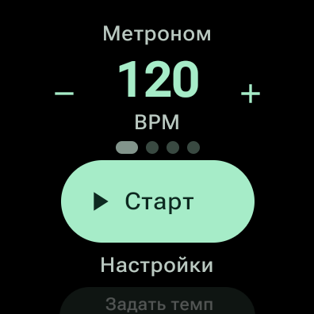

# Wear Metronome

Метроном для занятий музыкой на часах с Wear OS. Темп и доли видны на круглом экране, а ритм можно слышать или чувствовать на запястье.



## Возможности

- Темп **30–240 BPM**. Меняйте его кнопками `−` и `+`, поворотом безеля или нажимая «Задать темп» в нужном ритме.
- **1–8 долей в такте**. Текущая доля подсвечивается, а первая выделяется акцентом.
- Звук и вибрация включаются отдельно. Сила вибрации слабой и сильной долей настраивается от **0 до 100%** с шагом 5 процентных пунктов. При 0% выбранная доля не вибрирует.
- Подсветку можно сдвинуть относительно звука на **−200…+200 мс** с шагом 5 мс. Минус показывает долю раньше, плюс — позже. В настройках есть индикатор, на котором виден результат во время счёта.

Свайп вверх открывает настройки. Они сохраняются после закрытия приложения. Пока метроном играет, экран остаётся включённым. При выходе из приложения воспроизведение останавливается.

## Сборка

Нужны JDK 17 или новее и Android SDK Platform **37.0**. Для запуска нужны часы с Wear OS на Android 11 (API 30) или новее. Приложение собрано на Kotlin и Wear Compose Material 3.

```sh
./gradlew :app:assembleDebug
```

Готовый APK появится в `app/build/outputs/apk/debug/app-debug.apk`.

## Установка на часы

Включите беспроводную отладку и подключите часы и компьютер к одной сети. При первом подключении выполните сопряжение через `adb pair`. Для `adb connect` используйте порт с главного экрана беспроводной отладки. [Инструкция Samsung для Galaxy Watch](https://developer.samsung.com/health/sensor/guide/connect-watch.html)

```sh
adb pair WATCH_IP:PAIRING_PORT
adb connect WATCH_IP:DEBUG_PORT
adb -s WATCH_IP:DEBUG_PORT install -r app/build/outputs/apk/debug/app-debug.apk
adb -s WATCH_IP:DEBUG_PORT shell am start -n dev.metronome.wear/.MainActivity
```

## Проверка

```sh
./gradlew :app:lintDebug
```

Щелчки размещаются по позициям в непрерывном потоке PCM. Метроном использует метки аудиовывода, чтобы запланировать вибрацию и подсветку. В debug-сборке тег `MetronomeTiming` показывает позицию в потоке, расчётное время вывода, моменты отправки вибрации и подсветки и число опустошений буфера.

```sh
adb -s WATCH_IP:DEBUG_PORT shell setprop log.tag.MetronomeTiming DEBUG
adb -s WATCH_IP:DEBUG_PORT logcat -s MetronomeTiming:D
```

Для сравнения физического звука, вибрации и подсветки удобно записать несколько тактов при 120 BPM и четырёх долях. Начните запись перед нажатием «Старт», чтобы в неё попал первый удар.

## OpenSpec

[Воспроизведение](openspec/specs/metronome-playback/spec.md) и [настройки сигналов](openspec/specs/beat-feedback/spec.md) описывают текущее поведение приложения. Для проверки спецификаций требуется Node.js 22.12 или новее.

```sh
npx --yes @fission-ai/openspec@1.16.1 validate --all --strict
```
